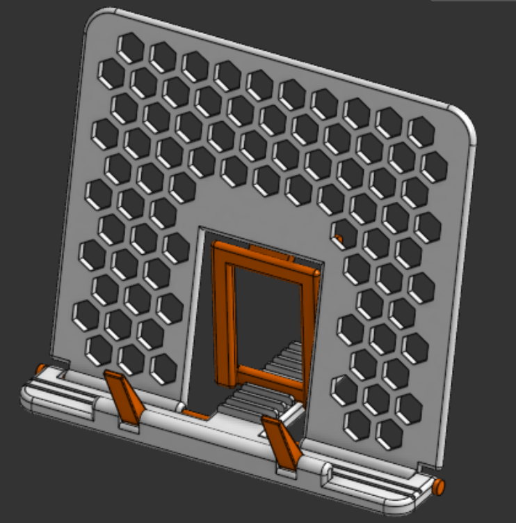
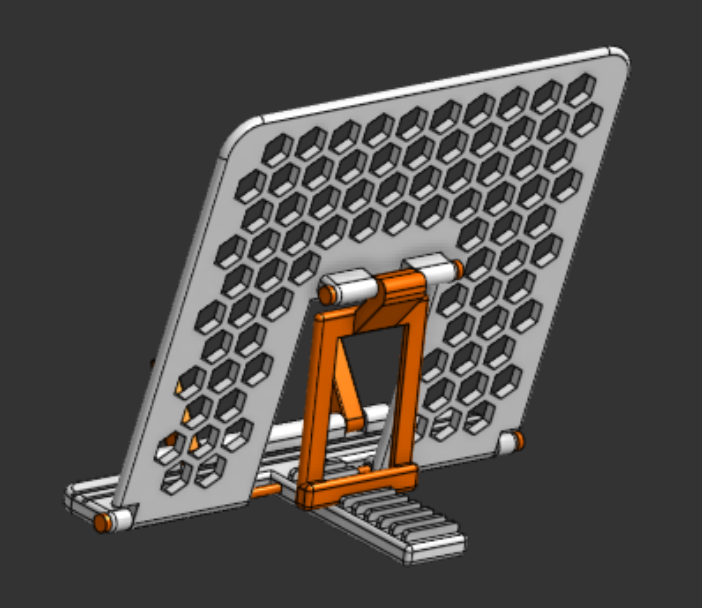

# book-stand
Sturdy, adjustable book stand designed to hold books at a comfortable reading incline.

## What is this?
Book Stand is a simple and sleek stand for readers who seek comfort while reading. This stand has an adjustable incline and also has an adjustable lock to secure the book or bookmark any pages. This design shares colors with my previous Organizer projects, i.e., Orange and White. Big and strong enough for varied books and thicknesses.





## Repository Structure
```text
book-stand/
1] Assets/----> All the images and visual references of the project
2] Hardware/--> Source design files
3] BOM.csv----> Bill of materials
4] LICENSE----> MIT License
5] README.md --> Detailed project documentation and instructions
```

## Live 3d view in Onshape
Click [here](https://cad.onshape.com/documents/caae6018893e4026057ddf68/w/a835b15fc11395aeb2de9005/e/6cf18027c6451f19cb631eb0) to view Book Stand in Onshape!

## How to get your own Book Stand?
1. Download the source CAD .step files from the [Hardware](Hardware/) directory
2. Import the file into your CAD editor and make edits as you want (Optional)
3. Go to your fabricater/ manufacturer website, get a quote, and purchase it (For Example, [ROBU](https://robu.in) or [JLCPCB](https://jlcpcb.com))
4. Wait for it to arrive
5. You will need superglue while assembling the stand
6. As seen in the image highlighted by different colors, please insert the locking stems and stick them with superglue
7. For the locks, you will need to press them slightly and attach them in the holes made, and they will automatically lock
8. That's it! Go enjoy your Book Stand!

## [BOM](BOM.csv) as a table
| Item     | Description  | Quantity | Price (USD) | Link                             |
|----------|--------------|----------|-------------|----------------------------------|
| 3D print | PLA (230 gm) | 1        | 12          | https://printlegion.hackclub.com |
| Shipping |              |          | 1           |                                  |
| Total    |              |          | 13          |                                  |

## Fabrication Specs
1. Printer- 0.2 mm Standard Quality
2. Material- PLA
3. Color- Orange & White
4. Infill- 50%

## License
[MIT](LICENSE)- Use, modify, share as you like!

## Notes
- If ya'll like this project, make sure to see my other projects [Hold 90](https://github.com/vd-sh/hold-90), [Tab Mount](https://github.com/vd-sh/tab-mount), or [Headset Stand](https://github.com/vd-sh/headset-stand)
- Or simply visit my [profile](https://github.com/vd-sh) to see the latest projects :)
